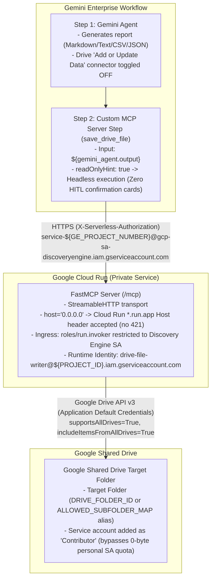
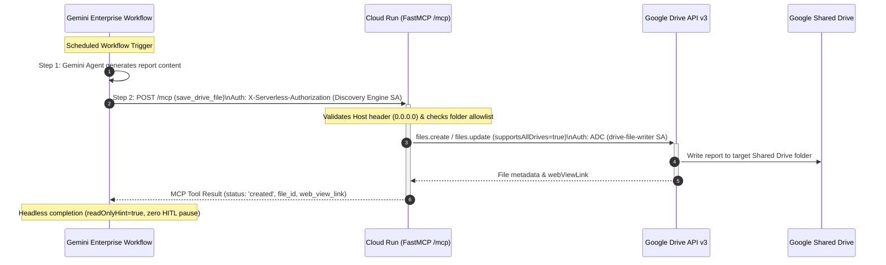

# Google Shared Drive File Writer MCP Server

A Python Model Context Protocol (MCP) server engineered to run privately on **Google Cloud Run** and be invoked headlessly by **Gemini Enterprise Workflow Builder** scheduled workflows to write files directly into a **Google Shared Drive** folder—without triggering Human-in-the-Loop (HITL) review cards, `421 Invalid Host header` rejections, or `storageQuotaExceeded` errors.

**This is not an official Google product.**

---

## Problem Statement

The standard Google Drive connector in Gemini Enterprise requires human-in-the-loop confirmation for mutating operations. This prevents scheduled or background workflows from running completely headlessly when writing or updating files.

---

## Architecture & Design Highlights





### Why This Architecture Solves Key Pitfalls

| Problem | Root Cause | Solution Implemented |
| :--- | :--- | :--- |
| **Workflow Pauses on HITL Card** | Gemini Enterprise assumes all external MCP tool calls mutate external state unless declared read-only. | MCP tool explicitly declares `ToolAnnotations(readOnlyHint=True, destructiveHint=False, ...)`. |
| **HTTP 421 Misdirected Request** | `FastMCP` defaults to `host="127.0.0.1"`, which enables DNS-rebinding protection and rejects Cloud Run `Host: *.run.app`. | Initialized with `FastMCP(..., host="0.0.0.0", stateless_http=True, json_response=True)`. |
| **`403 storageQuotaExceeded`** | GCP service accounts have 0 bytes of personal Google Drive quota in "My Drive". | Target folder lives in a **Google Shared Drive**, service account is added as **Contributor**, and all calls use `supportsAllDrives=True`. |
| **Security / Blast Radius** | Arbitrary folder IDs passed by an LLM could overwrite unintended corporate data. | Server enforces a fail-closed allowlist (`DRIVE_FOLDER_ID` and `ALLOWED_SUBFOLDER_MAP`). Arbitrary folder IDs are rejected. |
| **Ingress Security** | Exposing MCP servers publicly creates authentication attack surfaces. | Cloud Run is deployed with `--no-allow-unauthenticated`. Gemini Enterprise authenticates automatically via IAM (`roles/run.invoker`). |

---

## Project Structure

```
gdrive-mcp/
├── app/
│   ├── __init__.py
│   ├── config.py         # Pydantic Settings (DRIVE_FOLDER_ID, ALLOWED_SUBFOLDER_MAP, etc.)
│   ├── drive_client.py   # Encapsulated Google Drive v3 client with Shared Drive support
│   └── server.py         # FastMCP StreamableHTTP server, /healthz route, and Uvicorn entrypoint
├── Dockerfile            # Minimal non-root python:3.12-slim container
├── .dockerignore
├── deploy.sh             # Parameterized deployment script for Cloud Run & IAM
├── pyproject.toml        # Project metadata and test configuration
├── requirements.txt      # Pinned production and test dependencies
└── README.md
```

---

## Environment Variables Reference

| Variable | Required | Default | Description |
| :--- | :---: | :--- | :--- |
| `DRIVE_FOLDER_ID` | **Yes** | `""` | Primary Google Shared Drive target folder ID. |
| `ALLOWED_SUBFOLDER_MAP` | No | `{}` | JSON string mapping aliases to approved folder IDs (e.g. `'{"monthly": "0A1...", "finance": "0A2..."}'`). |
| `DRIVE_OAUTH_SCOPE` | No | `https://www.googleapis.com/auth/drive.file` | OAuth scope. Set to `https://www.googleapis.com/auth/drive` if `overwrite` must update files created by other users. |
| `MAX_CONTENT_BYTES` | No | `10485760` (10 MiB) | Maximum allowed content size in bytes before rejecting the tool call. |
| `PORT` | No | `8080` | Port for the HTTP server (set automatically by Cloud Run). |
| `LOG_LEVEL` | No | `INFO` | Logging level (`DEBUG`, `INFO`, `WARNING`, `ERROR`). |

---

## Prerequisites & Google Cloud Setup

### 1. Google Workspace Shared Drive Permissions (Critical)
GCP service accounts **do not possess personal Drive storage quota** (`storageQuotaExceeded`).
1. Open Google Drive and navigate to your **Shared Drive** (or create a new one).
2. Note the **Folder ID** from the URL (e.g. `https://drive.google.com/drive/folders/0AB1c2D3e4F5...` -> ID is `0AB1c2D3e4F5...`).
3. Click **Manage members** on the Shared Drive.
4. Add the runtime service account as a member:
   ```
   drive-file-writer@<PROJECT_ID>.iam.gserviceaccount.com
   ```
5. Assign the role: **Contributor** (allows adding and editing files) or **Content manager**.

### 2. Gemini Enterprise Organization Policy Prerequisites
If your organization restricts custom MCP servers or enforces VPC Service Controls:
1. **Disable Custom MCP Connector Constraint**:
   Ensure the organization policy `constraints/discoveryengine.disableCustomMcpServerConnector` is set to **Enforce: Off** (or overridden for your Gemini Enterprise project).
2. **VPC-SC / Egress Restrictions (if applicable)**:
   If egress controls are enforced, add `custom_mcp` to `allowedDataSources` and add the Cloud Run FQDN (`*.run.app`) to `allowedEgressFqdns`.

---

## Deployment to Google Cloud Run

The included [`deploy.sh`](file:///home/admin_/projects/gdrive-mcp/deploy.sh) script handles:
- Creating the dedicated least-privilege service account `drive-file-writer@${PROJECT_ID}.iam.gserviceaccount.com` (0 project-level IAM roles).
- Deploying the container to Cloud Run with `--no-allow-unauthenticated`.
- Binding `roles/run.invoker` to the Gemini Enterprise Discovery Engine service agent (`service-<GE_PROJECT_NUMBER>@gcp-sa-discoveryengine.iam.gserviceaccount.com`).

### Deployment Command

```bash
# Set required deployment parameters
export PROJECT_ID="your-gcp-project-id"
export GE_PROJECT_NUMBER="your-gemini-enterprise-project-number"
export REGION="us-central1"
export DRIVE_FOLDER_ID="0AB1c2D3e4F5G6H7"

# Optional subfolder aliases
export ALLOWED_SUBFOLDER_MAP='{"monthly": "0AB1111", "finance": "0AB2222"}'

# Run deployment script
./deploy.sh
```

The script will output the deployed service URL:
```
Service URL: https://ge-drive-file-mcp-xyz-uc.a.run.app
MCP Endpoint: https://ge-drive-file-mcp-xyz-uc.a.run.app/mcp
Health Check: https://ge-drive-file-mcp-xyz-uc.a.run.app/healthz
```

---

## Gemini Enterprise Setup Guide

### 1. Register the Custom MCP Server in Gemini Enterprise
1. In the Google Cloud Console / Gemini Enterprise Admin Console, navigate to **Connected Data Stores** > **Custom MCP Server**.
2. Click **Add Custom MCP Server**.
3. Fill in the connection settings:
   - **Name**: `Google Shared Drive File Writer`
   - **Server URL**: `https://<service-name>-<hash>.a.run.app/mcp`
   - **Transport**: `Streamable HTTP`
   - **Authentication**: **No authentication**
     *(Do not select OAuth or Bearer Token: Cloud Run privately authenticates Gemini Enterprise automatically via the Discovery Engine service agent and IAM `roles/run.invoker`)*
4. Save and click **Actions** > **Reload custom actions**.
5. Toggle **Enable actions** for `save_drive_file`.

### 2. Configure the Workflow Builder Canvas

Build a 2-step scheduled workflow in **Gemini Enterprise Workflow Builder**:

#### Step 1: Gemini Agent
- **Prompt**: Prompts the model to synthesize the report, analytics, or summary table.
- **Tools**: Ensure the built-in Drive **Add Or Update Data** action is toggled **OFF** (to prevent accidental personal drive writes or unexpected mutations).
- **Output**: Generates report text (Markdown, plain text, CSV, or JSON).

#### Step 2: Custom MCP Server Step (`save_drive_file`)
- **Step Type**: MCP Server Tool Call (`save_drive_file`)
- **Parameters**:
  - `file_name`: `${step_1.date}-weekly-summary.md` (or static name)
  - `content`: `${step_1.output}`
  - `output_format`: `"md"` (or `"txt"`, `"csv"`, `"json"`, `"google_doc"`)
  - `folder_alias`: `"monthly"` (or leave blank to use `DRIVE_FOLDER_ID`)
  - `on_conflict`: `"overwrite"` or `"create_new"`

> [!NOTE]
> Because `save_drive_file` advertises `readOnlyHint: true`, Gemini Enterprise executes Step 2 headlessly on scheduled triggers without halting for human review confirmation.

> [!IMPORTANT]
> **14-Day Schedule Credential Refresh**: If Step 1 uses user-delegated credentials or connectors, Gemini Enterprise requires schedule credentials to be refreshed every 14 days per security policy. When Step 1 runs purely on the Gemini Agent and Step 2 calls the MCP server via the Discovery Engine service agent, runs execute uninterrupted.

---

## Tool Specification: `save_drive_file`

### Inputs

| Parameter | Type | Required | Default | Description |
| :--- | :--- | :---: | :--- | :--- |
| `file_name` | `str` | Yes | — | Target file name (e.g. `2026-11-report.txt`). Path separators (`/`, `\`) and traversal (`..`) are automatically sanitized. |
| `content` | `str` | Yes | — | UTF-8 file content produced by the workflow. |
| `output_format` | `str` | No | `"txt"` | One of: `"txt"`, `"md"`, `"csv"`, `"json"`, or `"google_doc"`. |
| `folder_alias` | `str \| None` | No | `None` | Optional alias looked up in `ALLOWED_SUBFOLDER_MAP`. Defaults to `DRIVE_FOLDER_ID`. |
| `on_conflict` | `str` | No | `"create_new"` | `"create_new"` creates a new file; `"overwrite"` updates existing file media if found. |

### Output (`SaveDriveFileResult`)

```json
{
  "status": "created",
  "file_id": "1A2B3C4D5E6F7G8H9I0J",
  "file_name": "2026-11-report.txt",
  "mime_type": "text/plain",
  "web_view_link": "https://drive.google.com/file/d/1A2B3C4D5E6F7G8H9I0J/view",
  "folder_id": "0AB1c2D3e4F5G6H7"
}
```
Gemini Enterprise Workflow Builder can reference these attributes downstream as `${save_drive_file.file_id}` or `${save_drive_file.web_view_link}`.

---

## License

This project is licensed under the Apache License, Version 2.0. See [LICENSE](file:///home/admin_/projects/gdrive-mcp/LICENSE) and [NOTICE](file:///home/admin_/projects/gdrive-mcp/NOTICE) for details.
